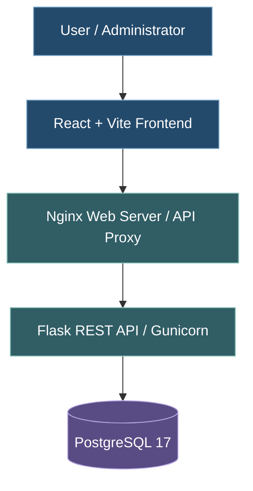
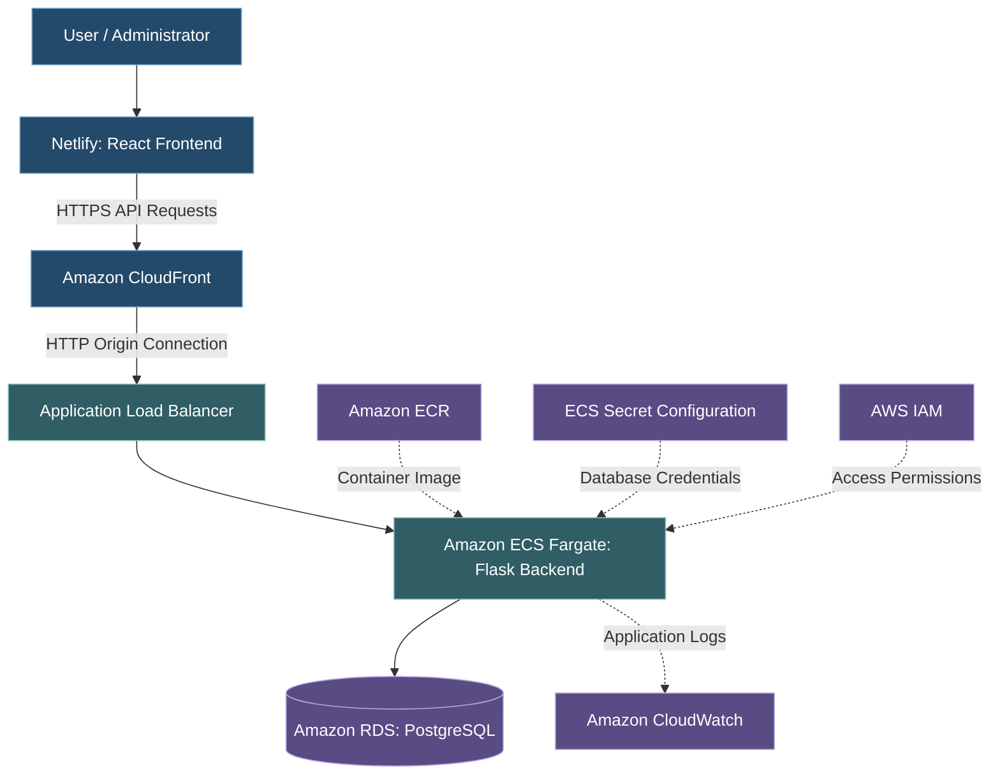
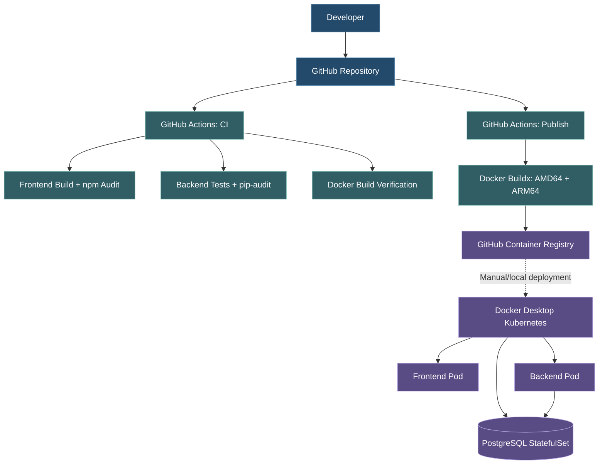
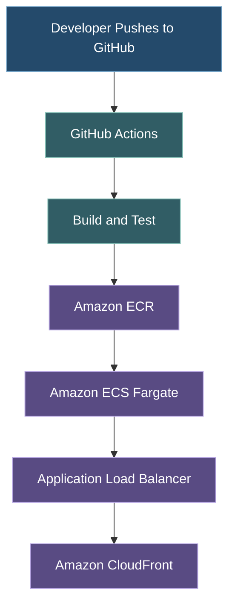

# ResponseCentral — Emergency Response Management System

**Course:** CSCI-4560 Database & System Management  
**Repository:** [Response-Central/Emergency-ResponseStarter](https://github.com/Response-Central/Emergency-ResponseStarter)  
**Live Application:** [ResponseCentral — Netlify](https://responsecentral.netlify.app/#/login)  
**AWS CloudFront:** [AWS Deployment](https://deymxwq1cqw7d.cloudfront.net/)  
**Interactive Architecture:** [Explore on GitDiagram](https://gitdiagram.com/response-central/emergency-responsestarter)

## Project Overview

ResponseCentral is a centralized emergency response management system designed to improve coordination between emergency calls, incidents, response units, dispatchers, and hospitals.

The project demonstrates how relational database management, full-stack development, containerization, cloud computing, and CI/CD can support emergency response operations.

The application is developed using React, Python Flask, and PostgreSQL, with cloud deployment using Netlify and Amazon Web Services (AWS).

### Project Objectives

- Centralize emergency calls and incident information.
- Track emergency response units and their availability.
- Support dispatch coordination and incident assignments.
- Manage hospital information and reservations.
- Improve access to emergency response data.
- Demonstrate secure database and application development.
- Implement automated testing and container deployment.
- Deploy a full-stack application using AWS cloud infrastructure.

## Live Deployment

ResponseCentral is deployed using Netlify and AWS.

| Service | URL |
|---|---|
| Live frontend | [responsecentral.netlify.app](https://responsecentral.netlify.app/#/login) |
| AWS CloudFront | [CloudFront Distribution](https://deymxwq1cqw7d.cloudfront.net/) |
| GitHub repository | [Emergency-ResponseStarter](https://github.com/Response-Central/Emergency-ResponseStarter) |
| Interactive architecture | [GitDiagram](https://gitdiagram.com/response-central/emergency-responsestarter) |

The Netlify frontend communicates with the AWS-hosted backend through API requests.

The Flask backend runs on Amazon ECS Fargate and connects to a PostgreSQL database hosted on Amazon RDS.

**Deployment Status:** The application has been deployed and its main workflows have been manually tested.

## Technology Stack

| Component | Technology | Purpose |
|---|---|---|
| Frontend | React 19 | Web application interface |
| Frontend build tool | Vite 8 | Frontend development and production builds |
| Backend | Python, Flask | REST API and business logic |
| Application server | Gunicorn | Python application hosting |
| Database | PostgreSQL 17 | Relational data storage |
| Web server | Nginx | Containerized frontend hosting and API reverse proxy |
| Containerization | Docker | Application packaging |
| Local orchestration | Docker Compose | Multi-container development |
| Kubernetes | Docker Desktop Kubernetes | Local container orchestration |
| Version control | Git, GitHub | Source code management |
| CI/CD | GitHub Actions | Automated testing and container publishing |
| Container registry | GitHub Container Registry (GHCR) | Published Docker images |
| AWS container registry | Amazon ECR | AWS Docker image storage |
| Cloud compute | Amazon ECS Fargate | Managed container hosting |
| Cloud database | Amazon RDS | Managed PostgreSQL |
| Load balancing | AWS Application Load Balancer | Backend traffic routing |
| Content delivery | Amazon CloudFront | HTTPS endpoint and content delivery |
| Frontend hosting | Netlify | Public React frontend deployment |
| Cloud monitoring | Amazon CloudWatch | Application logs and monitoring |
| Cloud security | AWS IAM | Roles and access permissions |
| Secret management | AWS ECS Secrets | Secure database credential injection |
| Development environment | Visual Studio Code | Development and debugging |
| Database administration | PostgreSQL tools | Database management and verification |
| Cloud management | AWS CLI | AWS resource configuration and management |

## System Architecture

ResponseCentral follows a three-tier architecture consisting of a React frontend, a Flask REST API, and a PostgreSQL database.

### Application Data Flow



This diagram represents the containerized application architecture used for local development and testing.

### Application Components

**Frontend:** Provides the user interface using React and Vite and communicates with the backend through API requests.

**Backend:** Handles application requests, business logic, database operations, and REST API endpoints using Flask. Gunicorn serves the backend in the containerized deployment.

**Database:** Uses PostgreSQL to store emergency calls, incidents, response units, hospitals, and related information.

### Interactive Repository Architecture

[**Open the ResponseCentral architecture on GitDiagram**](https://gitdiagram.com/response-central/emergency-responsestarter)

GitDiagram provides an interactive view of the repository's code structure and component relationships.

## AWS Cloud Architecture

ResponseCentral uses AWS to host the backend and PostgreSQL database while Netlify hosts the public frontend.

### AWS Deployment Diagram



### AWS Services

| AWS Service | Purpose |
|---|---|
| Amazon ECS | Manages containerized backend services |
| AWS Fargate | Runs containers without managing EC2 servers |
| Amazon ECR | Stores Docker images for AWS deployment |
| Amazon RDS | Hosts the PostgreSQL database |
| Application Load Balancer | Routes requests to ECS backend tasks |
| Amazon CloudFront | Provides an HTTPS-accessible distribution |
| Amazon CloudWatch | Collects application logs |
| AWS IAM | Manages AWS users, roles, and permissions |
| AWS Systems Manager | Supports ECS Exec for container administration |

### AWS Deployment Details

| Configuration | Value |
|---|---|
| AWS Region | `us-east-2` (Ohio) |
| ECS Cluster | `responsecentral-cluster` |
| Backend ECS Service | `responsecentral-backend-service` |
| Backend Container | `backend` |
| Backend Port | `5001` |
| Application Load Balancer | `responsecentral-alb` |
| RDS Instance | `responsecentral-db` |
| Database Name | `responsecentral` |
| Database Engine | PostgreSQL |

### AWS Deployment Process

The backend is packaged as a Docker container and deployed using Amazon ECS Fargate.

The deployment process includes:

1. Build the Flask backend Docker image.
2. Publish the container image to Amazon ECR.
3. Configure the ECS task definition.
4. Deploy the backend through an ECS service.
5. Configure the Application Load Balancer.
6. Connect the backend to Amazon RDS PostgreSQL.
7. Configure database credentials using ECS secrets.
8. Expose the application through CloudFront.
9. Connect the Netlify frontend to the backend API.
10. Verify application functionality and database persistence.

### AWS Database Deployment

The PostgreSQL database is hosted on Amazon RDS.

The database was initialized using the project's schema and migration scripts.

Database credentials are supplied through environment configuration and ECS secret references rather than hardcoded in application source files.

The database is configured without public accessibility.

### AWS Deployment Verification

The following checks have been completed:

- ECS backend service running.
- RDS PostgreSQL database available.
- Database schema initialized.
- Administrator account created.
- Frontend login tested.
- Emergency incident reporting tested.
- Application database persistence manually verified.
- RDS public accessibility disabled.
- RDS storage encryption enabled.
- PostgreSQL inbound access restricted by security group.
- Netlify HTTP-to-HTTPS redirection confirmed.
- CloudFront HTTP-to-HTTPS redirection confirmed.

**Current HTTPS limitation:** CloudFront communicates with the Application Load Balancer over HTTP. Full end-to-end transport encryption has not yet been configured or verified.

## Database Design

The PostgreSQL implementation includes the following tables:

| Table | General Purpose |
|---|---|
| `adminuser` | Administrator accounts |
| `adminsession` | Administrator sessions |
| `emergencycall` | Incoming emergency calls |
| `incident` | Emergency incidents |
| `incidentassignment` | Assignments of response resources to incidents |
| `responseunit` | Emergency response units |
| `hospital` | Hospital information |
| `hospitalreservation` | Hospital reservations |
| `location` | Location information |
| `geocodecache` | Cached geocoding results |

The database schema can be initialized using:

```bash
python manage.py init-db
```

For exact keys, constraints, and relationships, see the SQL files in the [`database/`](database/) directory.

## Getting Started

### Prerequisites

- Git
- Docker Desktop
- Node.js and npm
- Python 3
- PostgreSQL
- Visual Studio Code (recommended)
- kubectl and a local Kubernetes cluster for Kubernetes deployment
- AWS CLI for AWS administration

### Clone the Repository

```bash
git clone https://github.com/Response-Central/Emergency-ResponseStarter.git
cd Emergency-ResponseStarter
```

### Configure Environment Variables

```bash
cp .env.example .env
```

Edit `.env` to provide the required application settings and local database credentials.

**Never commit `.env`, passwords, API keys, or access tokens to GitHub.**

## How to Run ResponseCentral

### Option 1: Docker Compose (Recommended)

Docker Compose starts PostgreSQL, the Flask backend, and the React frontend served by Nginx.

**1. Build and start the containers**

```bash
docker compose up -d --build
```

**2. Initialize the database**

```bash
docker compose exec backend python manage.py init-db
```

**3. Optionally seed response units and create an administrator**

```bash
docker compose exec backend python manage.py seed-units
docker compose exec backend python manage.py create-admin
```

**4. Open the application**

| Service | URL |
|---|---|
| Frontend | http://localhost:8080 |
| API health check | http://localhost:8080/api/health |

**5. Inspect status or logs**

```bash
docker compose ps
docker compose logs -f
```

**6. Stop the application**

```bash
docker compose down
```

`docker compose down` stops and removes Compose containers and networks. It does not remove named database volumes unless volume removal is explicitly requested.

### Option 2: Local Development

This option runs the frontend and backend separately and requires an accessible PostgreSQL server.

**1. Create a Python virtual environment and install dependencies**

```bash
python3 -m venv .venv
source .venv/bin/activate
pip install -r requirements.txt
```

**2. Install frontend dependencies**

```bash
npm install
```

**3. Configure PostgreSQL**

Start PostgreSQL, configure the database connection in `.env`, and initialize the schema.

```bash
python manage.py init-db
```

**4. Start the backend**

```bash
python app.py
```

The backend should be accessible at:

http://localhost:5001

**5. Start the frontend in another terminal**

```bash
npm run dev
```

Open the URL displayed by Vite, typically:

http://localhost:5173

The Vite development proxy forwards `/api` requests to the Flask backend.

### Option 3: Local Kubernetes

Requires Docker Desktop Kubernetes, `kubectl`, and access to the private GHCR images.

Kubernetes manifests are located in [`k8s/`](k8s/).

**1. Check the cluster and create the namespace**

```bash
kubectl get nodes
kubectl apply -f k8s/namespace.yaml
```

**2. Configure Kubernetes Secrets**

The deployment expects two existing Secrets in the `responsecentral` namespace:

- `postgres-credentials`: PostgreSQL credentials required by the manifests.
- `ghcr-credentials`: Docker registry pull credentials for private GHCR images.

Create these using authorized credentials and the secret keys required by the YAML manifests.

Do not commit secret values or registry tokens to the repository.

**3. Deploy PostgreSQL, backend, and frontend**

```bash
kubectl apply -f k8s/postgres.yaml
kubectl apply -f k8s/backend.yaml
kubectl apply -f k8s/frontend.yaml
```

**4. Verify the deployment**

```bash
kubectl get pods -n responsecentral
kubectl get services -n responsecentral
kubectl rollout status deployment/backend -n responsecentral
kubectl rollout status deployment/frontend -n responsecentral
```

**5. Initialize a fresh database**

```bash
kubectl -n responsecentral exec deployment/backend -- python manage.py init-db
```

**6. Access the application**

```bash
kubectl -n responsecentral port-forward service/frontend 8081:80
```

Open:

http://localhost:8081

Test the health endpoint:

http://localhost:8081/api/health

**7. Troubleshoot**

```bash
kubectl get pods -n responsecentral
kubectl logs deployment/backend -n responsecentral
kubectl logs deployment/frontend -n responsecentral
```

### Kubernetes Configuration Files

| File | Description |
|---|---|
| `k8s/namespace.yaml` | Creates the `responsecentral` namespace |
| `k8s/postgres.yaml` | PostgreSQL StatefulSet, persistent storage, and service |
| `k8s/backend.yaml` | Flask backend Deployment and service |
| `k8s/frontend.yaml` | React/Nginx frontend Deployment and service |

### Verified Local Kubernetes Status

The local deployment has been verified with PostgreSQL, Flask, and React/Nginx pods running, the backend health endpoint returning HTTP 200, and the PostgreSQL schema initialized.

Expected API health response:

```json
{
  "message": "Python API is running"
}
```

These checks verify the infrastructure and health endpoint, not every application workflow.

## Docker Container Images

GitHub Actions publishes two multi-platform images to GitHub Container Registry.

| Component | Image |
|---|---|
| Frontend | `ghcr.io/response-central/responsecentral-frontend:latest` |
| Backend | `ghcr.io/response-central/responsecentral-backend:latest` |

Both images support `linux/amd64` and `linux/arm64`.

The publishing workflow also tags images with the full Git commit SHA.

Authentication may be required because the packages can be private.

AWS deployment uses Amazon ECR for container images.

## CI/CD Pipeline

ResponseCentral uses GitHub Actions for automated testing and container publishing.

### Continuous Integration

Workflow: [`.github/workflows/ci.yml`](.github/workflows/ci.yml)

The CI workflow performs:

1. Frontend dependency installation and production build.
2. JavaScript dependency security audit using `npm audit`.
3. Backend integration testing with PostgreSQL.
4. Python dependency security audit using `pip-audit`.
5. Docker image build verification.

### Container Publishing

Workflow: [`.github/workflows/publish.yml`](.github/workflows/publish.yml)

The publishing workflow authenticates with GitHub Container Registry and uses Docker Buildx to build AMD64 and ARM64 images.

The frontend and backend images are published using `latest` and commit-SHA tags.

### CI/CD Architecture



**Note:** Kubernetes deployment is performed separately from image publishing.

### AWS CI/CD Status

The AWS backend has been deployed to Amazon ECS Fargate.

Automatic deployment from GitHub Actions to Amazon ECR and ECS has not yet been confirmed as configured.

Currently, publishing a Docker image to GitHub Container Registry does not automatically update the running ECS service.

### Planned AWS Deployment Automation



This diagram represents the planned automated AWS deployment workflow.

## Security and Privacy

### Application Security

- Administrator authentication and session management.
- Password hashing.
- Parameterized database queries.
- Input validation and protected administrative endpoints.
- Environment-based application configuration.

### AWS Infrastructure Security

- Amazon RDS is not publicly accessible.
- PostgreSQL inbound access is restricted by security group.
- RDS storage encryption is enabled.
- Database credentials are referenced through ECS secrets.
- Secure cookie configuration is enabled.
- Netlify redirects HTTP traffic to HTTPS.
- CloudFront redirects HTTP traffic to HTTPS.
- AWS IAM roles control access to AWS resources.
- ECS Exec supports authorized container administration.

### HTTPS Configuration

The public Netlify and CloudFront endpoints use HTTPS.

The current CloudFront-to-ALB origin connection uses HTTP because the ALB has an HTTP listener on port 80.

Full end-to-end HTTPS encryption is a future improvement.

### Data Privacy

ResponseCentral is an academic demonstration project.

Use **synthetic or non-sensitive demonstration data**.

The application is not intended for live emergency dispatch or storage of real patient information without additional security, operational, and regulatory safeguards.

**HIPAA compliance has not been established.**

## Testing and Verification

| Component | Verification |
|---|---|
| React frontend | `npm run build` |
| JavaScript dependencies | `npm audit --audit-level=high` |
| Python dependencies | `pip-audit` |
| Backend | Automated Python tests |
| Database | PostgreSQL schema verification |
| Docker | Container build and startup |
| Kubernetes | Pod and rollout status |
| API | `/api/health` endpoint |
| CI/CD | GitHub Actions workflow results |
| AWS ECS | Service and task status |
| AWS RDS | Database connectivity and schema |
| AWS ALB | Listener and routing configuration |
| CloudFront | HTTP-to-HTTPS redirect |
| Netlify | HTTPS frontend access |
| Application | Login, incident reporting, and database persistence |

## Project Structure

```text
Emergency-ResponseStarter/
├── .github/
│   └── workflows/
│       ├── ci.yml
│       └── publish.yml
├── database/
├── k8s/
│   ├── namespace.yaml
│   ├── postgres.yaml
│   ├── backend.yaml
│   └── frontend.yaml
├── src/
├── app.py
├── manage.py
├── database.py
├── dispatch.py
├── geocoding.py
├── hospitals.py
├── compose.yaml
├── Dockerfile.backend
├── Dockerfile.frontend
├── nginx.conf
├── package.json
├── package-lock.json
├── requirements.txt
├── vite.config.js
├── .env.example
└── README.md
```

## Future Improvements

- Improve response-unit availability tracking and real-time incident updates.
- Optimize database queries and caching.
- Expand CloudWatch monitoring and audit logging.
- Integrate additional hospital capacity information.
- Enhance role-based access control.
- Implement and test automated backup and recovery.
- Improve deployment rollback and recovery procedures.
- Expand automated integration and end-to-end testing.

## Disclaimer

ResponseCentral is developed for educational and demonstration purposes.

It is **not an official emergency dispatch system** and should not be relied upon for real-world emergency response.

## Repository

[GitHub — Response-Central/Emergency-ResponseStarter](https://github.com/Response-Central/Emergency-ResponseStarter)
