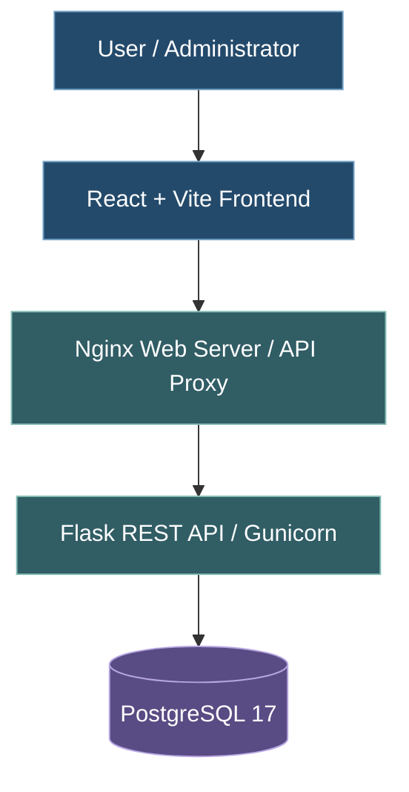
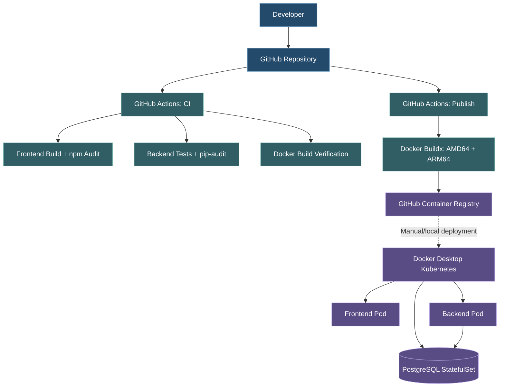
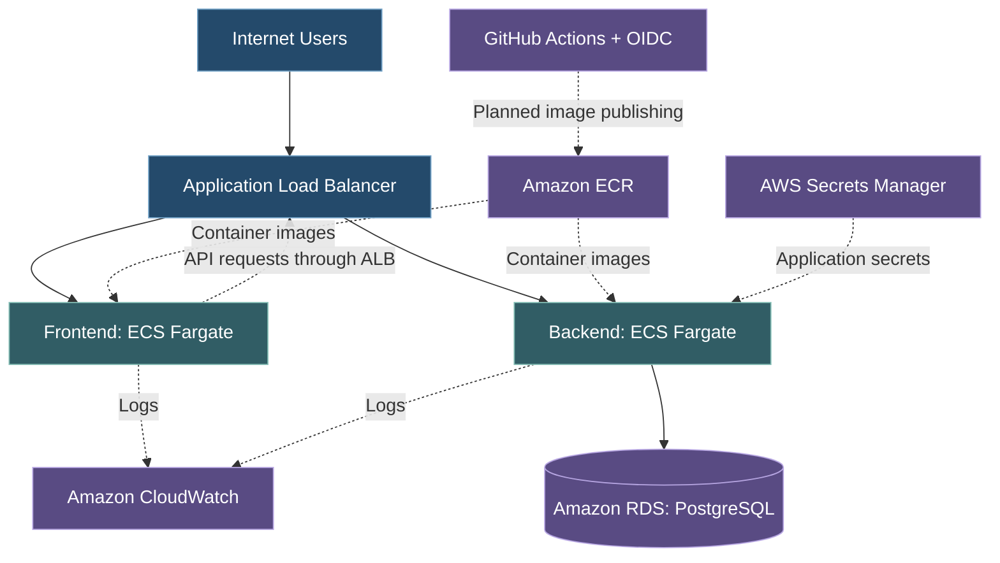

# ResponseCentral — Emergency Response Management System

ResponseCentral is a centralized emergency response management system designed to improve coordination of emergency calls, incidents, response units, and hospitals. The project demonstrates how database management, full-stack development, containerization, and CI/CD can support emergency response operations.

**Course:** CSCI-4560 Database & System Management  
**Repository:** [Response-Central/Emergency-ResponseStarter](https://github.com/Response-Central/Emergency-ResponseStarter)  
**Interactive code architecture:** [Explore ResponseCentral on GitDiagram](https://gitdiagram.com/response-central/emergency-responsestarter)

## Project Overview

Emergency response operations require fast access to accurate information. Disconnected systems, manual communication, and delayed updates can make coordination more difficult. ResponseCentral aims to provide a unified platform for emergency incidents and response resources.

### Project Objectives

- Centralize emergency calls and incident information.
- Track emergency response units and their availability.
- Support dispatch coordination and incident assignments.
- Manage hospital information and reservations.
- Improve access to emergency response data.
- Demonstrate secure database and application development.
- Implement automated testing and container deployment.

## Technology Stack

| Component | Technology | Purpose |
|---|---|---|
| Frontend | React 19, Vite 8 | Web application |
| Backend | Python, Flask | REST API and business logic |
| Application server | Gunicorn | Python application hosting |
| Database | PostgreSQL 17 | Relational data storage |
| Web server | Nginx | Frontend hosting and API reverse proxy |
| Containerization | Docker | Application packaging |
| Local orchestration | Docker Compose | Multi-container development |
| Kubernetes | Docker Desktop Kubernetes | Local container orchestration |
| CI/CD | GitHub Actions | Automated checks and image publishing |
| Container registry | GitHub Container Registry (GHCR) | Published Docker images |
| Planned cloud hosting | AWS ECS Fargate | Managed container hosting |
| Planned cloud database | Amazon RDS | Managed PostgreSQL |
| Planned cloud monitoring | Amazon CloudWatch | Logs and monitoring |

## System Architecture

ResponseCentral follows a three-tier architecture: a React frontend, a Flask REST API, and a PostgreSQL database. Nginx serves the production frontend and proxies API requests to Flask.

### Application Data Flow



### Application Components

**Frontend:** Provides the user interface using React and Vite, and communicates with the backend through API requests.

**Backend:** Handles application requests, business logic, database operations, and REST API endpoints using Flask. Gunicorn serves the backend in the containerized deployment.

**Database:** Uses PostgreSQL to store emergency calls, incidents, response units, hospitals, and related information.

### Interactive Repository Architecture

[**Open the ResponseCentral architecture on GitDiagram**](https://gitdiagram.com/response-central/emergency-responsestarter)

GitDiagram provides an interactive view of the repository's code structure and component relationships. This external link is used instead of an unverified image URL, so the README does not display a broken image placeholder.

## Database Design

The current PostgreSQL implementation includes the following tables:

| Table | General purpose |
|---|---|
| `adminuser` | Administrator accounts |
| `adminsession` | Administrator sessions |
| `emergencycall` | Incoming emergency calls |
| `incident` | Emergency incidents |
| `incidentassignment` | Assignments of response resources to incidents |
| `responseunit` | Emergency response units |
| `hospital` | Hospital information |
| `hospitalreservation` | Hospital reservations |
| `location` | Location information |
| `geocodecache` | Cached geocoding results |

The database schema is initialized using `python manage.py init-db` in the appropriate backend environment. For the exact keys, constraints, and relationships, see the schema files in [`database/`](database/).

## Getting Started

### Prerequisites

- **Git** to clone the repository.
- **Docker Desktop** for the recommended local deployment.
- **Node.js and npm** for standalone frontend development.
- **Python 3** for standalone backend development.
- **PostgreSQL** if running the database outside Docker.
- **kubectl and a local Kubernetes cluster** only for the Kubernetes option.

### Clone the Repository

```bash
git clone https://github.com/Response-Central/Emergency-ResponseStarter.git
cd Emergency-ResponseStarter
```

### Configure Environment Variables

```bash
cp .env.example .env
```

Edit `.env` to provide the required application settings and local database credentials. **Never commit `.env`, passwords, API keys, or access tokens to GitHub.**

## How to Run ResponseCentral

### Option 1: Docker Compose (Recommended)

Docker Compose starts PostgreSQL, the Flask backend, and the React frontend served by Nginx.

**1. Build and start the containers**

```bash
docker compose up -d --build
```

**2. Initialize the database (first run / fresh database)**

```bash
docker compose exec backend python manage.py init-db
```

**3. Optionally seed response units and create an administrator**

```bash
docker compose exec backend python manage.py seed-units
docker compose exec backend python manage.py create-admin
```

**4. Open the application**

| Service | URL |
|---|---|
| Frontend | http://localhost:8080 |
| API health check | http://localhost:8080/api/health |

**5. Inspect status or logs**

```bash
docker compose ps
docker compose logs -f
```

**6. Stop the application**

```bash
docker compose down
```

`docker compose down` stops and removes the Compose containers and network; it does not remove named database volumes unless you explicitly request volume removal.

### Option 2: Local Development (Without Docker for the App)

This option runs the frontend and backend separately and requires an accessible PostgreSQL server.

**1. Create a Python virtual environment and install backend dependencies**

```bash
python3 -m venv .venv
source .venv/bin/activate
pip install -r requirements.txt
```

**2. Install frontend dependencies**

```bash
npm install
```

**3. Configure PostgreSQL**

Start PostgreSQL, create/configure the database as needed, and update the database connection values in `.env`. Initialize the schema:

```bash
python manage.py init-db
```

**4. Start the backend (terminal 1)**

```bash
python app.py
```

The backend should be accessible at http://localhost:5001.

**5. Start the frontend (terminal 2)**

```bash
npm run dev
```

Open the URL displayed by Vite, typically http://localhost:5173. The Vite development proxy forwards `/api` requests to the Flask backend.

### Option 3: Local Kubernetes

Requires Docker Desktop Kubernetes, `kubectl`, and access to the private GHCR images. The manifests are in [`k8s/`](k8s/).

**1. Check your cluster and create the namespace**

```bash
kubectl get nodes
kubectl apply -f k8s/namespace.yaml
```

**2. Configure Kubernetes Secrets**

The deployment expects two existing Secrets in the `responsecentral` namespace:

- `postgres-credentials`: PostgreSQL credentials required by the manifests.
- `ghcr-credentials`: Docker registry pull credentials for the private GHCR images.

Create these using authorized credentials and the secret keys required by the YAML manifests. Do not commit secret values or a registry token to the repository.

**3. Deploy PostgreSQL, backend, and frontend**

```bash
kubectl apply -f k8s/postgres.yaml
kubectl apply -f k8s/backend.yaml
kubectl apply -f k8s/frontend.yaml
```

**4. Verify the deployment**

```bash
kubectl get pods -n responsecentral
kubectl get services -n responsecentral
kubectl rollout status deployment/backend -n responsecentral
kubectl rollout status deployment/frontend -n responsecentral
```

**5. Initialize a fresh database**

```bash
kubectl -n responsecentral exec deployment/backend -- python manage.py init-db
```

**6. Access the application**

```bash
kubectl -n responsecentral port-forward service/frontend 8081:80
```

Open http://localhost:8081 and test http://localhost:8081/api/health. Keep the port-forward terminal open while using the application.

**7. Troubleshoot**

```bash
kubectl get pods -n responsecentral
kubectl logs deployment/backend -n responsecentral
kubectl logs deployment/frontend -n responsecentral
```

### Kubernetes Configuration Files

| File | Description |
|---|---|
| `k8s/namespace.yaml` | Creates the `responsecentral` namespace |
| `k8s/postgres.yaml` | PostgreSQL StatefulSet, persistent storage, and service |
| `k8s/backend.yaml` | Flask backend Deployment and service |
| `k8s/frontend.yaml` | React/Nginx frontend Deployment and service |

### Verified Local Kubernetes Status

The local deployment has been verified with PostgreSQL, Flask, and React/Nginx pods running, the backend health endpoint returning HTTP 200, and the PostgreSQL schema initialized.

Expected API health response:

```json
{
  "message": "Python API is running"
}
```

These checks verify the infrastructure and health endpoint; they do not constitute full end-to-end testing of every application workflow.

## Docker Container Images

GitHub Actions publishes two multi-platform images to GitHub Container Registry:

| Component | Image |
|---|---|
| Frontend | `ghcr.io/response-central/responsecentral-frontend:latest` |
| Backend | `ghcr.io/response-central/responsecentral-backend:latest` |

Both images support `linux/amd64` and `linux/arm64`. The publishing workflow also tags images with the full Git commit SHA. Authentication may be required because the packages can be private.

## CI/CD Pipeline

ResponseCentral uses GitHub Actions for automated testing and container publishing.

### Continuous Integration

Workflow: [`.github/workflows/ci.yml`](.github/workflows/ci.yml)

The CI workflow performs:

1. Frontend dependency installation and production build.
2. JavaScript dependency security audit (`npm audit`).
3. Backend integration testing with PostgreSQL.
4. Python dependency security audit (`pip-audit`).
5. Docker image build verification.

### Container Publishing

Workflow: [`.github/workflows/publish.yml`](.github/workflows/publish.yml)

The publishing workflow authenticates with GHCR, uses Docker Buildx to build AMD64 and ARM64 images, and publishes the frontend and backend images with `latest` and commit-SHA tags.

### CI/CD Architecture



**Note:** Kubernetes deployment is performed separately from the image-publishing workflow; publishing an image does not automatically deploy it to the local cluster.

## AWS Cloud Deployment (In Progress)

The planned AWS deployment uses managed cloud services. AWS infrastructure provisioning and application verification are separate from the completed local Docker Compose and Kubernetes checks.

### Proposed AWS Architecture



The diagram represents the **target architecture**, not a claim that the AWS services are already deployed. Production networking, TLS, IAM roles, security groups, and service configuration must be implemented and validated during deployment.

### Planned AWS Services

| AWS Service | Purpose |
|---|---|
| Amazon ECR | Container image registry |
| Amazon ECS | Container orchestration |
| AWS Fargate | Managed container compute |
| Amazon RDS | Managed PostgreSQL database |
| Application Load Balancer | HTTP/HTTPS routing |
| AWS Secrets Manager | Secure application secrets |
| Amazon CloudWatch | Logs and monitoring |
| AWS IAM | Identity and access management |
| GitHub Actions OIDC | Short-lived CI/CD authentication |

**Status:** AWS deployment is in progress. The local application has been tested with Docker Compose and Kubernetes; AWS deployment will be documented after infrastructure and application checks succeed.

## Security and Privacy

### Application Security

- Administrator authentication and session management.
- Password hashing.
- Parameterized database queries.
- Input validation and protected administrative endpoints.
- Environment-based application configuration.

### Infrastructure Security

- Secrets excluded from source control.
- Kubernetes Secrets for sensitive configuration.
- Dependency security audits and container build checks.
- IAM-based AWS access control.
- Planned HTTPS, encrypted cloud storage, monitoring, and restricted network access.

### Data Privacy

ResponseCentral is an academic demonstration project. Use **synthetic or non-sensitive demonstration data**. It is not intended for live emergency dispatch or storage of real patient information without additional security, operational, and regulatory safeguards.

**HIPAA compliance has not been established.**

## Testing and Verification

| Component | Verification |
|---|---|
| React frontend | `npm run build` |
| JavaScript dependencies | `npm audit --audit-level=high` |
| Python dependencies | `pip-audit` |
| Backend | Automated Python tests |
| Database | PostgreSQL schema verification |
| Docker | Container build and startup |
| Kubernetes | Pod and rollout status |
| API | `/api/health` endpoint |
| CI/CD | GitHub Actions workflow results |

## Project Structure

```text
Emergency-ResponseStarter/
├── .github/
│   └── workflows/
│       ├── ci.yml
│       └── publish.yml
├── database/
├── k8s/
│   ├── namespace.yaml
│   ├── postgres.yaml
│   ├── backend.yaml
│   └── frontend.yaml
├── src/
├── app.py
├── manage.py
├── database.py
├── dispatch.py
├── geocoding.py
├── hospitals.py
├── compose.yaml
├── Dockerfile.backend
├── Dockerfile.frontend
├── nginx.conf
├── package.json
├── package-lock.json
├── requirements.txt
├── vite.config.js
├── .env.example
└── README.md
```

## Future Improvements

- Complete and verify the AWS cloud deployment.
- Automate deployment through GitHub Actions.
- Improve response-unit availability tracking and real-time incident updates.
- Optimize database queries and caching.
- Expand monitoring and audit logging.
- Integrate hospital capacity information.
- Enhance role-based access control.
- Implement and test automated backup and recovery.

## Disclaimer

ResponseCentral is developed for educational and demonstration purposes. It is **not an official emergency dispatch system** and should not be relied upon for real-world emergency response.

## Repository

[GitHub — Response-Central/Emergency-ResponseStarter](https://github.com/Response-Central/Emergency-ResponseStarter)
